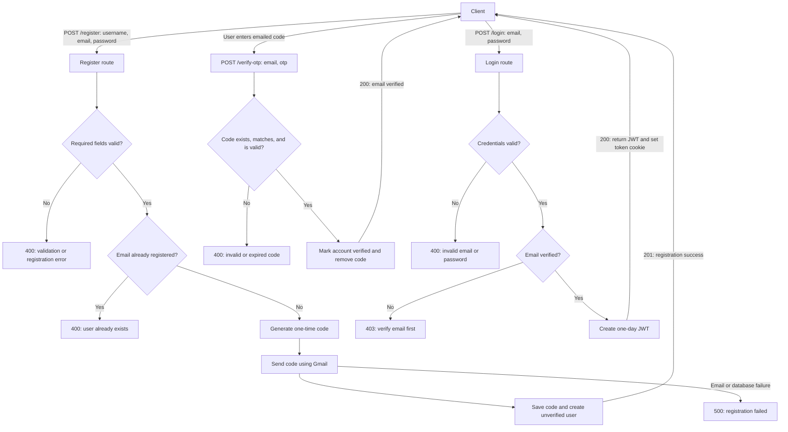

# Login API

This is the Express/MongoDB backend for user registration, email verification, and login.

## Setup

Requirements: Node.js and a MongoDB instance.

1. Open a terminal in `backend`.
2. Install dependencies:

   ```sh
   npm install
   ```

3. Create a `.env` file in the `backend` directory with your own values:

   ```dotenv
   PORT=5000
   MONGO_URI=mongodb://127.0.0.1:27017/login
   JWT_SECRET=replace-with-a-long-random-secret
   EMAIL_USER=your-gmail-address@gmail.com
   PASS_USER=your-16-character-google-app-password
   ```

   `PORT` is optional and defaults to `5000`. Keep `.env` private and never commit or share it.

4. Start the API:

   ```sh
   npm run dev
   ```

   Or use `npm start` for a regular start. The API base path is `http://localhost:<PORT>/api/auth` (`5000` by default).

## Routes

All request bodies are JSON. The routes are public; login returns a JWT after email verification.

### `POST /api/auth/register`

Create an unverified user and start the email verification process.

Request:

```json
{
  "username": "alex",
  "email": "alex@example.com",
  "password": "choose-a-password"
}
```

Expected flow:

1. Validate the required fields and check whether the email is already registered.
2. Remove any previous OTP record for the email.
3. Generate and send a verification code by email.
4. Hash the password and create the user as unverified.
5. Return `201 Created` with a success message.

Possible responses include `400` for missing fields or an already-registered email, and `500` if registration fails.

### `POST /api/auth/verify-otp`

Verify the email using the code sent during registration.

Request:

```json
{
  "email": "alex@example.com",
  "otp": "123456"
}
```

The intended flow is to find the stored code, confirm that it matches and has not expired, mark the user verified, and remove the code. A successful response is `200 OK`.

### `POST /api/auth/login`

Log in with a verified account.

Request:

```json
{
  "email": "alex@example.com",
  "password": "choose-a-password"
}
```

Expected flow:

1. Find the account and compare the submitted password with its stored hash.
2. Reject invalid credentials with `400`; reject an unverified account with `403`.
3. Create a JWT that expires in one day, set it in the `token` cookie, and return it with the user's public details.

Successful response (`200 OK`):

```json
{
  "message": "Login successfully",
  "token": "<jwt>",
  "user": {
    "id": "<user-id>",
    "username": "alex",
    "email": "alex@example.com"
  }
}
```

## Registration and email verification flow



### Gmail app password

The mailer uses `EMAIL_USER` for the Gmail account and `PASS_USER` for its app password. Do not put your normal Google password in `PASS_USER`.

1. Sign in to the Google Account that will send verification emails.
2. Turn on **2-Step Verification** in Google Account **Security** settings.
3. Open **App passwords** from the Security settings. Google may ask you to sign in again.
4. Create an app password (choose a descriptive name such as `Login API`) and copy the generated 16-character password.
5. Put the Gmail address in `EMAIL_USER` and the generated app password in `PASS_USER` in `backend/.env`. If Google displays spaces in the app password, enter it without spaces.
6. Restart the backend after changing `.env`.

App passwords may be unavailable for some account types or organization policies. If you cannot find the setting, check that 2-Step Verification is enabled or ask your Google Workspace administrator.

## Current OTP implementation caveat

The diagram describes the expected application flow. Before relying on email verification, confirm the configured Gmail app password works and test that registration sends a code, incorrect or expired codes are rejected, and a valid code can only verify the matching account.
