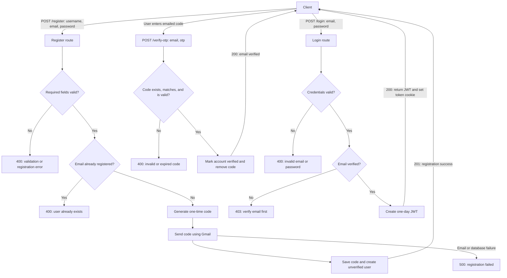

# Login API

This is the Express/MongoDB backend for user registration, email verification, and login.

## Setup

Requirements: Node.js and a MongoDB instance.

1. Open a terminal in `backend`.
2. Install dependencies:

   ```sh
   npm install
   ```

3. Create a `.env` file in the `backend` directory with your own values:

   ```dotenv
   PORT=5000
   MONGO_URI=mongodb://127.0.0.1:27017/login
   JWT_SECRET=replace-with-a-long-random-secret
   EMAIL_USER=your-gmail-address@gmail.com
   PASS_USER=your-16-character-google-app-password
   ```

   `PORT` is optional and defaults to `5000`. Keep `.env` private and never commit or share it.

4. Start the API:

   ```sh
   npm run dev
   ```

   Or use `npm start` for a regular start. The API base path is `http://localhost:<PORT>/api/auth` (`5000` by default).

## Routes

All request bodies are JSON. The routes are public; login returns a JWT after email verification.

### `POST /api/auth/register`

Create an unverified user and start the email verification process.

Request:

```json
{
  "username": "alex",
  "email": "alex@example.com",
  "password": "choose-a-password"
}
```

Expected flow:

1. Validate the required fields and check whether the email is already registered.
2. Remove any previous OTP record for the email.
3. Generate and send a verification code by email.
4. Hash the password and create the user as unverified.
5. Return `201 Created` with a success message.

Possible responses include `400` for missing fields or an already-registered email, and `500` if registration fails.

### `POST /api/auth/verify-otp`

Verify the email using the code sent during registration.

Request:

```json
{
  "email": "alex@example.com",
  "otp": "123456"
}
```

The intended flow is to find the stored code, confirm that it matches and has not expired, mark the user verified, and remove the code. A successful response is `200 OK`.

### `POST /api/auth/login`

Log in with a verified account.

Request:

```json
{
  "email": "alex@example.com",
  "password": "choose-a-password"
}
```

Expected flow:

1. Find the account and compare the submitted password with its stored hash.
2. Reject invalid credentials with `400`; reject an unverified account with `403`.
3. Create a JWT that expires in one day, set it in the `token` cookie, and return it with the user's public details.

Successful response (`200 OK`):

```json
{
  "message": "Login successfully",
  "token": "<jwt>",
  "user": {
    "id": "<user-id>",
    "username": "alex",
    "email": "alex@example.com"
  }
}
```

## Step-by-step email and OTP implementation

The email verification feature is usually built in this order. In this project, the logic is split across the controller, model, utility, and email template files.

### Step 1: Install the email package

Add `nodemailer` to the backend so the server can send emails through Gmail.

```bash
npm install nodemailer
```

> You may also need `dotenv` if your project loads environment variables from a `.env` file.

### Step 2: Add email credentials in `.env`

Use your Gmail address and Google app password.

```dotenv
EMAIL_USER=your-gmail-address@gmail.com
PASS_USER=your-16-character-google-app-password
```

### Step 3: Create the mail sender utility

Create `backend/src/utilies/email.utiles.js` and configure the Gmail transporter. The `type` value lets the template show the correct context such as `registration` or `login`.

```js
const nodemailer = require("nodemailer");
const textforemial = require("../template/email");

// Create a Gmail SMTP transporter.
const transporter = nodemailer.createTransport({
  service: "gmail",
  auth: {
    user: process.env.EMAIL_USER,
    pass: process.env.PASS_USER,
  },
});

// Send a one-time password (OTP) email.
const sendEmail = async function ({ email, otp, type = "verification" }) {
  try {
    const mailOptions = {
      from: {
        name: "TXO Company",
        address: process.env.EMAIL_USER,
      },
      to: email,
      subject: `TXO | Your OTP Code for Verification`,
      html: textforemial(otp),
    };

    // Send the email using the configured SMTP transporter.
    const info = await transporter.sendMail(mailOptions);

    console.log("Email sent successfully:", info.messageId);

    return {
      success: true,
      messageId: info.messageId,
    };
  } catch (error) {
    console.error("Email sending failed:", error.message);
    throw new Error("Unable to send OTP email");
  }
};

module.exports = sendEmail;
```

### Step 4: Create the HTML email template

Create `backend/src/template/email.js` with a styled HTML email that includes the OTP value inside a card. The function receives the OTP and a `type` string so you can reuse the same template for different flows.

```js
function textforemial(otp) {
  return `
<!DOCTYPE html>
<html>
<head>
  <meta charset="UTF-8" />
  <meta name="viewport" content="width=device-width, initial-scale=1.0" />
</head>
<body style="margin:0; padding:0; background-color:#f4f6f9; font-family:Arial, Helvetica, sans-serif;">
  <table width="100%" cellpadding="0" cellspacing="0" style="padding:40px 15px;">
    <tr>
      <td align="center">
        <table width="100%" cellpadding="0" cellspacing="0" style="max-width:520px; background:#ffffff; border-radius:14px; overflow:hidden;">
          <tr>
            <td align="center" style="background:#111827; padding:32px 20px;">
              <h1 style="margin:0; color:#ffffff; font-size:30px; letter-spacing:3px;">TXO</h1>
              <p style="margin:8px 0 0; color:#9ca3af; font-size:12px; letter-spacing:2px;">TECHNOLOGY & INNOVATION</p>
            </td>
          </tr>

          <tr>
            <td style="padding:35px 30px; color:#374151;">
              <h2 style="margin:0 0 15px; color:#111827; font-size:23px;">Verify Your Email Address</h2>

              <p style="font-size:14px; line-height:1.7; color:#6b7280;">
                Hello,<br /><br />
                Thank you for choosing TXO. To complete your verification, please use the secure one-time password provided below.
              </p>

              <table width="100%" cellpadding="0" cellspacing="0" style="background:#f3f4f6; border:1px solid #e5e7eb; border-radius:10px; margin:25px 0;">
                <tr>
                  <td align="center" style="padding:25px 15px;">
                    <p style="margin:0 0 12px; color:#6b7280; font-size:12px; letter-spacing:2px;">YOUR VERIFICATION CODE</p>
                    <h1 style="margin:0; color:#111827; font-size:34px; letter-spacing:10px;">${otp}</h1>
                    <p style="margin:15px 0 0; color:#dc2626; font-size:12px;">Expires in 5 minutes</p>
                  </td>
                </tr>
              </table>

              <p style="font-size:13px; line-height:1.7; color:#6b7280;">
                <strong style="color:#111827;">Security Notice:</strong> Never share this verification code with anyone.
              </p>
            </td>
          </tr>
        </table>
      </td>
    </tr>
  </table>
</body>
</html>
  `;
}

module.exports = textforemial;
```

### Step 5: Save OTPs in the database

Create `backend/src/models/otp.model.js` so each email gets a generated OTP and an expiration time. This prevents users from reusing a stale code.

```js
const mongoose = require("mongoose");

const otpSchema = new mongoose.Schema(
  {
    // Store the user's email so we can find the correct OTP record.
    email: {
      type: String,
      required: true,
    },

    // Store the generated six-digit code.
    otp: {
      type: String,
      required: true,
    },

    // Expire the OTP after 10 minutes to keep the verification flow secure.
    expiresAt: {
      type: Date,
      required: true,
      default: () => new Date(Date.now() + 10 * 60 * 1000),
    },
  },
  { timestamps: true },
);

const otpModel = mongoose.model("Otp", otpSchema);
module.exports = otpModel;
```

### Step 6: Generate OTP during registration

Inside `backend/src/controller/auth.controller.js`, create the OTP as soon as a new user registers. Delete any old OTP for that email before generating a new one.

```js
const userMOdel = require("../models/user.model");
const bcrypt = require("bcrypt");
const sendEmail = require("../utilies/email.utiles");
const otpModel = require("../models/otp.model");

module.exports.register = async function (req, res) {
  try {
    const { email, password, username } = req.body;

    if (!email || !password || !username) {
      return res.status(400).json({ errors: "All field required" });
    }

    const isUserExists = await userMOdel.findOne({ email });

    if (isUserExists) {
      return res.status(400).json({ errors: "User already exists" });
    }

    // Remove old OTP records so the latest code is the only valid one.
    await otpModel.deleteMany({ email });

    // Generate a random 6-digit OTP.
    const otp = Math.floor(100000 + Math.random() * 900000).toString();

    // Send OTP to the user's email.
    await sendEmail({ email, otp, type: "registration" });

    // Store the OTP so it can be checked later.
    await otpModel.create({ email, otp });

    // Hash password before saving the user.
    const hashPassword = await bcrypt.hash(password, 10);

    await userMOdel.create({
      username,
      email,
      password: hashPassword,
    });

    return res.status(201).json({
      message: "User registered successfully. Please verify your email.",
    });
  } catch (error) {
    console.log("register not working", error);
    return res.status(500).json({ errors: "Registration failed" });
  }
};
```

### Step 7: Verify the OTP

After the user receives the email, they send the code back to the API. The backend compares it with the stored OTP and marks the account as verified.

```js
module.exports.verifyOtp = async function (req, res) {
  try {
    const { email, otp } = req.body;

    if (!email || !otp) {
      return res.status(400).json({ errors: "Email and OTP are required" });
    }

    // Find the latest OTP saved for this email.
    const savedOtp = await otpModel.findOne({ email });

    if (!savedOtp) {
      return res.status(400).json({ errors: "Invalid or expired OTP" });
    }

    // Compare submitted code with the stored code.
    if (String(savedOtp.otp) !== String(otp)) {
      return res.status(400).json({ errors: "Incorrect OTP" });
    }

    // Mark the user as verified.
    const user = await userMOdel.findOneAndUpdate(
      { email },
      { $set: { isverified: true } },
      { new: true },
    );

    if (!user) {
      return res.status(404).json({ errors: "User not found" });
    }

    // Delete OTP after success so it cannot be reused.
    await otpModel.deleteMany({ email });

    return res.status(200).json({
      message: "Email verified successfully",
    });
  } catch (error) {
    console.log("OTP verification not working", error);
    return res.status(500).json({ errors: "OTP verification failed" });
  }
};
```

### Step 8: Re-send OTP when login is blocked by verification

If the user has not verified their email yet, the login endpoint should generate a new OTP and send it again.

```js
if (!user.isverified) {
  // Inform the user that they must verify their email first.
  return res.status(403).json({
    errors: "Please verify your email before logging in",
  });
}
```

In a more user-friendly version, you can generate a new OTP before returning the error so the user can verify immediately.

### Step 9: Route setup

Define the API endpoints in `backend/src/rotues/auth.rotues.js`.

```js
const router = require("express").Router();
const { body } = require("express-validator");
const authController = require("../controller/auth.controller");

router.post(
  "/register",
  [
    body("email").isEmail().withMessage("Valid email is required"),
    body("password").notEmpty().withMessage("Password is required"),
    body("username").notEmpty().withMessage("username is required"),
  ],
  authController.register,
);

router.post(
  "/verify-otp",
  [
    body("email").isEmail().withMessage("Valid email is required"),
    body("otp").notEmpty().withMessage("OTP is required"),
  ],
  authController.verifyOtp,
);

module.exports = router;
```

### Important notes

1. Always delete old OTPs before creating a new one for the same email.
2. Keep the OTP short-lived and store `expiresAt` in the database.
3. Use Gmail app passwords, not your normal Google password.
4. Always hash passwords before saving a user.
5. Verify the email before allowing login.

This step-by-step flow matches the project structure and makes it easier to implement and debug email verification in a secure way.

## Registration and email verification flow



### Gmail app password

The mailer uses `EMAIL_USER` for the Gmail account and `PASS_USER` for its app password. Do not put your normal Google password in `PASS_USER`.

1. Sign in to the Google Account that will send verification emails.
2. Turn on **2-Step Verification** in Google Account **Security** settings.
3. Open **App passwords** from the Security settings. Google may ask you to sign in again.
4. Create an app password (choose a descriptive name such as `Login API`) and copy the generated 16-character password.
5. Put the Gmail address in `EMAIL_USER` and the generated app password in `PASS_USER` in `backend/.env`. If Google displays spaces in the app password, enter it without spaces.
6. Restart the backend after changing `.env`.

App passwords may be unavailable for some account types or organization policies. If you cannot find the setting, check that 2-Step Verification is enabled or ask your Google Workspace administrator.

## Current OTP implementation caveat

The diagram describes the expected application flow. Before relying on email verification, confirm the configured Gmail app password works and test that registration sends a code, incorrect or expired codes are rejected, and a valid code can only verify the matching account.